# Architecture

The Agendai API is a NestJS application in front of PostgreSQL. The code is organized by feature, and every business row belongs to one tenant. This page explains how the pieces fit. The [data model](data-model.md) and [authentication](authentication.md) pages cover the details of those two areas.

## Containers

Docker Compose starts four services. The database comes up first. The `migrate` service then applies the migrations and exits, and the API starts only after that succeeds. Prometheus scrapes the API's metrics endpoint.

[Open the interactive version](diagrams/system-architecture.html).

The API sends traces, logs and metrics to NestJS Observe only when `OBSERVE_APP_KEY` and `OBSERVE_APP_SECRET` are set. Without them it runs normally and sends nothing. See [Observability](observability.md).

## Module layout

Each business capability lives in its own folder under `src/features/`. Code that several features share lives in `src/shared/`.

Each feature folder holds its controller, service, schemas and module. These rules keep the features independent:

- A feature imports another feature only through its module or its exported classes, never through its internal files.
- `auth` imports `users`. `users` imports only the `AccessPolicy` class from `auth`. The dependency runs in one direction.
- The database schema stays in one file, `src/shared/database/schema.ts`, because Drizzle needs a single schema to generate migrations.

## Request flow

A request that writes data passes through three steps: the bearer token resolves the user, the access policy checks the user's role, and the service writes the row with the caller's tenant.

[Open the interactive version](diagrams/create-unit-request.html).

## Tenancy

The database uses one shared schema. Every business table has a `tenant_id` column. The access token identifies a user, and that user's `tenantId` scopes every query in the services. A request cannot name a tenant. A body field called `tenantId` is ignored.

Services check cross-references before they write. For example, creating a professional verifies that the unit and the user both belong to the caller's tenant. The `tenants` table itself has no `tenant_id`, and neither does `refresh_tokens`, which holds state for the authentication library.

`users.email` is unique across all tenants. One email address therefore maps to one user, in one tenant. Sign-up returns `409 Conflict` for an address that is already registered anywhere.

## Roles and authorization

There are three roles. Every route is protected by `@Can()` or `@Public()`. A route with neither is denied.

| Role | Read units, services and professionals | Create, update and delete them | Create members |
| --- | --- | --- | --- |
| `admin` | Yes | Yes | Yes |
| `professional` | Yes | No | No |
| `client` | Yes | No | No |

The rules live in `AccessPolicy` (`src/features/auth/access.policy.ts`). A signed-in user who lacks the role receives `403 Forbidden`. A request without a valid token receives `401 Unauthorized`.

## Current scope

The API covers sign-up and sign-in, members, the CRUD endpoints for units, services and professionals, and the availability of individual services in a unit. The tables for schedules, time off, bookings, class sessions, the waitlist and the outbox already exist. No endpoint writes to schedules, time off or bookings yet, so they are filled directly in the database for now. The [API](api.md) page lists what is available today.
