# Data model

The schema has twelve tables. This page explains what each one holds and which rules the database enforces. The [data model reference](generated/data-model.md) lists every column, and it is regenerated from the source.

[Open the interactive version](diagrams/data-model.html).

## Tables by domain

| Domain | Tables | What they hold |
| --- | --- | --- |
| Tenancy and people | `tenants`, `users` | A clinic, and the people who sign in to it. |
| Scheduling setup | `units`, `services`, `professionals`, `schedules`, `time_off` | Where work happens, what is offered, who offers it, when, and when they are unavailable. |
| Bookings | `bookings` | Reservations of a professional for a client over an absolute time range. |
| Classes | `class_sessions`, `waitlist_entries` | Sessions with several seats, and the clients waiting for a seat. |
| Platform | `outbox_events`, `refresh_tokens` | Events waiting to be published, and refresh-token state for the authentication library. |

## Tenant scope

Every business table has a `tenant_id` column that references `tenants.id` with `ON DELETE CASCADE`. Deleting a tenant removes its rows. The `tenants` table has no `tenant_id`. The `refresh_tokens` table has none either, because it belongs to the authentication library. Queries that read business tables must filter by `tenant_id`.

## Times

Two kinds of time appear in the schema:

- `schedules` stores weekday, start time and end time as local times. The design reads them in the timezone that `units.timezone` stores. The database does not enforce that link, so the code that reads schedules must apply it.
- `time_off`, `bookings` and `class_sessions` store a `tstzrange` period. A period is an absolute instant range, so it does not depend on a timezone.

## Integrity rules

The database enforces these rules, so they hold even when the application has a bug.

- `users.email` is unique across all tenants.
- `professionals.user_id` is unique, so one user is at most one professional.
- `services` requires a duration above zero, a buffer of zero or more, and a capacity of at least one.
- `schedules` requires a weekday from 0 to 6, and a start time before the end time.
- `class_sessions` requires a capacity of at least one.
- `waitlist_entries` allows one entry per client and session, and one entry per position within a session.
- `bookings` enforces a unique `(tenant_id, idempotency_key)`. The database rejects a second row with the same key in the same tenant, so the service can rely on that to make a retry safe.
- `bookings`, `class_sessions` and `time_off` reject empty periods.
- No professional can hold two overlapping bookings whose status is `pending` or `confirmed`. This is an exclusion constraint in the `booking_constraints` migration. Drizzle cannot express it, so it lives in SQL.

## Deletes

Deletes that would orphan data are refused, and the API answers `409 Conflict`:

- A unit that still has professionals cannot be deleted.
- A service that is used by a class session cannot be deleted.
- A professional that has bookings cannot be deleted.

Deleting a professional removes its schedules and time-off periods. Deleting a session removes its waitlist entries.

## Booking statuses

The `booking_status` enum has five values: `pending`, `confirmed`, `cancelled`, `completed` and `no_show`. No code sets these values yet. The availability endpoint reads `pending` and `confirmed` as busy time. The transitions between them belong to the booking work, which is not built yet.

A booking's `period` must cover its service and its buffer. The table does not store the service, so availability cannot add the buffer itself.

## Where to go next

- For the columns, keys and constraints of each table, read the [data model reference](generated/data-model.md).
- For how the tenant reaches each query, read [Architecture](architecture.md).
- For the migration files and how to apply them, read [Operations](operations.md).
