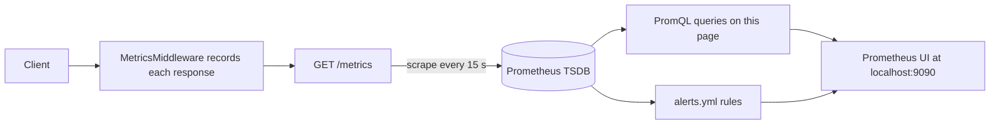

# Monitoring queries

The queries on this page read the API's request traffic and its processing cost in Prometheus. Each query runs on the metrics that [Observability](observability.md) describes. The queries are grouped in two parts: requests, which answer how the API serves its clients, and processing, which answers what the Node.js process spends to do it.



Run the queries in the Prometheus UI at `http://localhost:9090/graph`, or send them to the HTTP API:

```bash
curl -s http://localhost:9090/api/v1/query --data-urlencode 'query=sum(rate(agendai_http_requests_total[5m]))'
```

## Requests

The queries in this part follow the RED method: rate, errors and duration.

### Rate

The requests per second, in total and by route:

```promql
sum(rate(agendai_http_requests_total[5m]))

sum by (route) (rate(agendai_http_requests_total[5m]))
```

The `route` label is the route template, such as `/units/:id/availability`, so each route stays one series. A request that matches no route is counted under `unmatched`.

### Errors

The share of responses in each status class:

```promql
# Client errors (4xx), as a share of all requests
sum(rate(agendai_http_requests_total{status=~"4.."}[5m])) / sum(rate(agendai_http_requests_total[5m]))

# Server errors (5xx), as a share of all requests
sum(rate(agendai_http_requests_total{status=~"5.."}[5m])) / sum(rate(agendai_http_requests_total[5m]))

# Requests per second by route and status
sum by (route, status) (rate(agendai_http_requests_total[5m]))
```

A high 4xx share is not always a fault. Unauthenticated calls return `401`, and calls to unknown paths return `404`. Read the 4xx share by route before you treat it as an incident.

### Duration

Latency percentiles come from the histogram buckets, and the average comes from its sum and count:

```promql
# 95th percentile by route
histogram_quantile(0.95, sum by (le, route) (rate(agendai_http_request_duration_seconds_bucket[5m])))

# Average duration by route
sum by (route) (rate(agendai_http_request_duration_seconds_sum[5m]))
  / sum by (route) (rate(agendai_http_request_duration_seconds_count[5m]))

# Share of requests slower than 500 ms
1 - (sum(rate(agendai_http_request_duration_seconds_bucket{le="0.5"}[5m])) / sum(rate(agendai_http_request_duration_seconds_count[5m])))
```

A percentile is only as precise as the buckets. The buckets run from 5 ms to 5 s, so use one of their bounds, such as `0.5` or `1`, as the threshold in the last query.

## Processing

Node.js process metrics show what the traffic in the first part costs, and they point to the cause when latency grows.

### CPU and memory

CPU and memory of the process, from the default Node.js metrics:

```promql
# CPU cores in use (user and system time per second)
rate(agendai_process_cpu_user_seconds_total[5m]) + rate(agendai_process_cpu_system_seconds_total[5m])

# Resident memory of the process, in bytes
agendai_process_resident_memory_bytes

# Heap used by V8, in bytes
agendai_nodejs_heap_size_used_bytes

# Open file descriptors as a share of the limit
agendai_process_open_fds / agendai_process_max_fds
```

### Event loop

The event loop lag is the delay before queued work runs. A lag that grows with traffic means the process is busy with synchronous work:

```promql
agendai_nodejs_eventloop_lag_p99_seconds

agendai_nodejs_eventloop_lag_p50_seconds
```

The node-level lag gauges are not per route, so read them next to the latency queries above.

### Garbage collection

The collection rate by kind. Frequent major collections usually mean heap pressure:

```promql
sum by (kind) (rate(agendai_nodejs_gc_duration_seconds_count[5m]))

sum by (kind) (rate(agendai_nodejs_gc_duration_seconds_sum[5m]))
```

### In-flight work and uptime

Work still open in the process, and how long the process has been running:

```promql
# Requests and handles still open in the process
agendai_nodejs_active_requests_total
agendai_nodejs_active_handles_total

# Seconds since the process started. A value that drops to zero shows a restart.
time() - agendai_process_start_time_seconds
```

## Reading empty results

A query can return no series or `NaN`, and that is not always an error:

- A series appears only after its first request. A route that nothing has called is absent.
- `rate()` needs at least two samples in its window. Right after a restart, or with no traffic in the last five minutes, rates are zero or missing.
- Ratios and percentiles divide by a rate that can be zero, so they return `NaN` when there is no traffic.
- Counters restart from zero when the API restarts, so read them with `rate()` or `increase()`, not as raw totals.

## Where to go next

- The alert rules that use these queries are in `prometheus/alerts.yml`, and the [Observability](observability.md#alert-rules) page lists them.
- If a query returns nothing, check the target with the steps in [Observability](observability.md#check-that-it-works).
